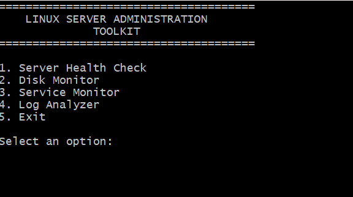
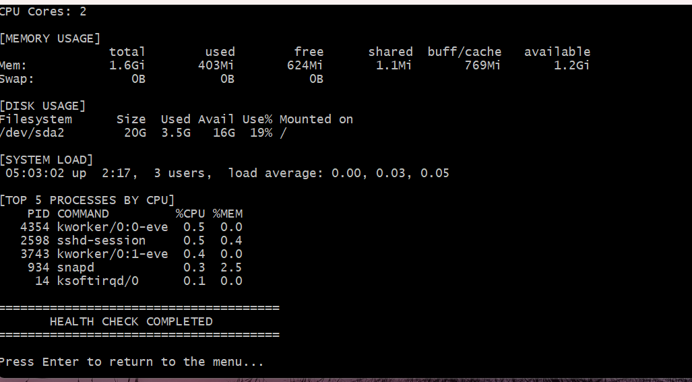
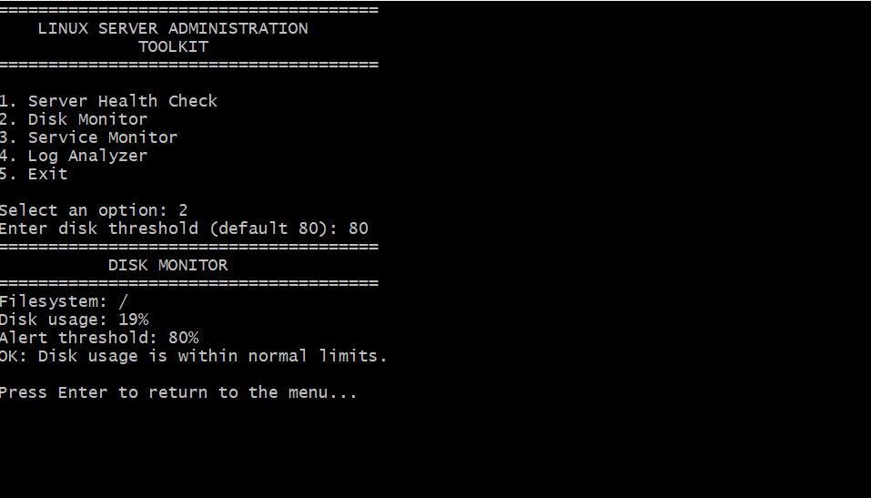
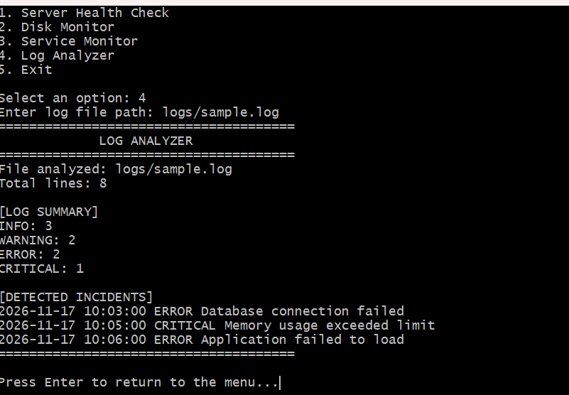

# Linux Server Administration Toolkit

A command-line toolkit built with Bash and Python to monitor Linux server resources, inspect system services, and analyze log files.

## Overview

This project provides four utilities for basic Linux server administration:

- **Server Health Check:** Displays CPU information, memory usage, disk space, uptime, and top processes.
- **Disk Monitor:** Checks filesystem usage and generates alerts based on configurable thresholds.
- **Service Monitor:** Checks whether selected Linux services are active, inactive, or unavailable.
- **Log Analyzer:** Analyzes log files and identifies INFO, WARNING, ERROR, and CRITICAL messages.

## Technologies

- Linux
- Bash
- Python 3
- systemd
- Git

## Project Structure

```text
linux-server-administration-toolkit/
├── scripts/
│   ├── server_health_check.sh
│   ├── disk_monitor.sh
│   └── service_monitor.sh
├── python/
│   └── log_analyzer.py
├── logs/
│   └── sample.log
├── screenshots/
├── toolkit.sh
├── README.md
├── .gitignore
└── LICENSE
```

## Requirements

- Linux environment
- Bash
- Python 3
- systemd
- Standard Linux utilities: `df`, `free`, `ps`, `awk`, and `systemctl`


## Installation

Clone the repository:

```bash
git clone https://github.com/rubenalejandrorivera-eng/linux-server-administration.git
```

Enter the project directory:

```bash
cd linux-server-administration
```

Grant execution permissions:

```bash
chmod +x toolkit.sh
chmod +x scripts/*.sh
```

## Usage

Launch the main application:

```bash
./toolkit.sh
```

Select one of the available tools from the interactive menu.

### Run individual tools

Server Health Check:

```bash
./scripts/server_health_check.sh
```

Disk Monitor:

```bash
./scripts/disk_monitor.sh 80
```

Service Monitor:

```bash
./scripts/service_monitor.sh
```

Log Analyzer:

```bash
python3 python/log_analyzer.py logs/sample.log
```

## Disk Monitor Exit Codes

| Exit code | Meaning |
|---|---|
| 0 | Disk usage is within the configured threshold |
| 1 | Warning: threshold exceeded |
| 2 | Critical condition or invalid input |

## Example Use Cases

- Checking server resource utilization.
- Identifying high disk usage.
- Verifying whether important services are running.
- Investigating application errors through log analysis.
- Practicing Linux administration and troubleshooting.

## Screenshots

### Main Menu


### Server Health Check


### Disk Monitor


### Log Analyzer



